# WildScope — where animals have been recorded

**Live:** https://d2za8aq0bl0uib.cloudfront.net

WildScope is a 3D globe for exploring **recorded animal occurrences** from the
[GBIF](https://www.gbif.org) occurrence snapshot hosted in the
[Registry of Open Data on AWS](https://registry.opendata.aws/gbif/). Start at the whole planet,
fly down to a single neighbourhood, and the map changes from aggregated hexagons to the individual
records behind them, each with its date, location, licence and, when one is licensed for reuse, a
photograph.

Built for the AWS Builder Center **"Weekend Challenge: Map it"**. The original product and
engineering specification is in [`wildscope-product-blueprint/`](wildscope-product-blueprint/README.md).

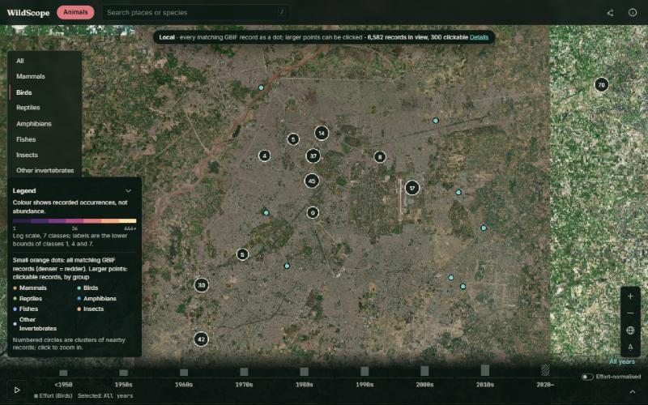
*Birds around Lahore: 6,582 GBIF records in view (live count on 2026-11-01), clustered over Amazon Location satellite imagery.*

> **Records are not presence or absence.** A place with no records says nothing about whether an animal
> lives there, and fewer records in a decade do not mean fewer animals. WildScope shows where people have
> recorded animals, and always labels where each number comes from.

---

## Contents

1. [Problem](#problem) · 2. [Objectives](#objectives) · 3. [Key features](#key-features) ·
4. [Screenshots](#screenshots) · 5. [Dataset](#dataset) · 6. [Processing and filtering](#data-processing-and-filtering) ·
7. [Architecture](#architecture) · 8. [AWS services](#aws-services) · 9. [Tech stack](#technical-stack) ·
10. [Versioning and caching](#data-versioning-and-caching) · 11. [Error handling](#error-handling-and-retries) ·
12. [Local development](#installation-and-local-development) · 13. [Environment variables](#environment-variables) ·
14. [Deployment](#deployment) · 15. [Testing](#testing-and-validation) · 16. [Limitations](#performance-and-known-limitations) ·
17. [Future work](#future-improvements) · 18. [License](#license-and-acknowledgements)

More detail: [Architecture](docs/architecture.md) · [Challenge alignment](docs/challenge-alignment.md) ·
[Demo script](docs/demo-script.md) · [Review and test log](docs/REVIEW.md)

---

## Problem

GBIF holds billions of biodiversity records, but they are hard to explore geographically:

- The raw snapshot on AWS is **303 GB of Parquet in 10,448 files** (verified 2026-10-31), far too big to
  browse directly.
- Most maps of occurrence data either show one coarse grid at every zoom or a sample of points, so they
  either hide the actual records or misrepresent how many there are.
- Raw counts mislead: they track **where observers go**, not where animals are. Without the sampling
  effort beside them, a rise or fall in records is easy to misread.

## Objectives

- Make the GBIF snapshot explorable on a globe, from the planet down to individual records.
- Use real data only: every figure on screen comes from the data build or from GBIF at request time, and
  says which.
- Put sampling effort next to every species count, and never imply absence, decline or abundance.
- Run on a small, static-first AWS footprint that is cheap to keep online.

## Key features

| Feature | What it does | Source of the data shown |
|---|---|---|
| **Three zoom levels** | Global (camera ≥ 8,000 km): H3 resolution 2 cells. Regional (1,200–8,000 km): H3 resolution 4 cells with edges. Local (< 1,200 km): individual records. 10% hysteresis between levels. A status bar names the level and the source. | Snapshot build / GBIF API |
| **Local records** | Every matching record as a density dot, plus up to 300 records as clickable points coloured by group and clustered by screen distance (clusters split as you zoom). | GBIF occurrence + Maps API, live |
| **Record cards** | Species, common name, date, coordinates ± stated uncertainty, recorder, dataset, licence, IUCN category on the record, link to the GBIF record; photos only when the image is CC0 or CC BY. | GBIF, live |
| **Animal groups** | Mammals, Birds, Reptiles, Amphibians, Fishes (grouped), Insects, Other invertebrates. Filters every layer. | Snapshot + GBIF |
| **Species search and species mode** | Search scientific or common names; the globe then shows only that species, the camera fits the central 98% of its records, and the panel shows names, taxonomy, records by decade, top countries, licence mix, IUCN category and photos. | Snapshot + GBIF |
| **Place search** | Find a place and fly to it. | Amazon Location Service Places, via Lambda |
| **Cell summaries** | Click a cell: records, distinct species, contributing datasets, records by decade, by group, top species, share without stated uncertainty. | Snapshot (region files) |
| **Records in view** | At the local level: GBIF's total for the view, top species, records by IUCN category, records by class. | GBIF, live |
| **Timeline** | Nine periods (before 1950, the 1950s … 2010s, 2020 onwards (partial)), Play, an effort strip beside every species series, and an effort-normalised mode (records ÷ effort, with low-effort cells hatched). The period filters the live records too. | Snapshot + GBIF |
| **Data notes** | Snapshot id, every filter stage with its count, duplicate rule, biases, sources, licences and citation. | Build manifest |
| **Share links** | The URL stores group, species, period, mode, camera and dataset id. | — |

The Trees lens from the original spec is **not** included: there is no settled, licensed list of which
plant species are trees.

## Screenshots

All screenshots are captures of the live site taken on 2026-11-01 (1440×900 viewport, scaled).

| | |
|---|---|
| 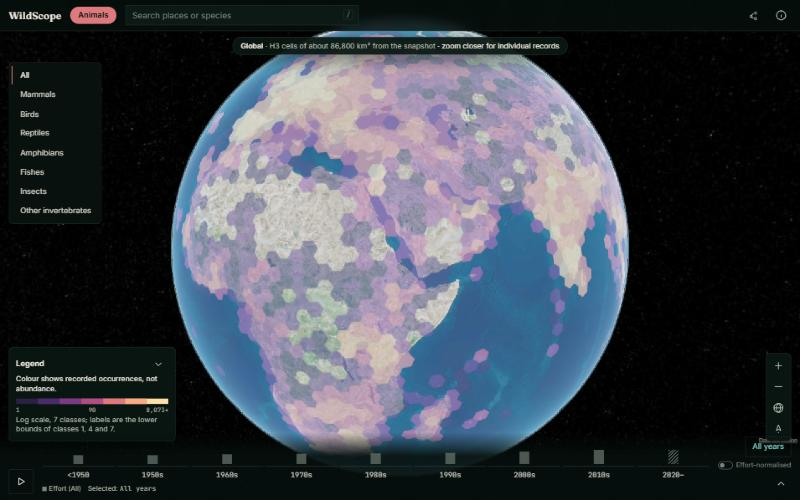 **Global:** H3 res-2 cells over satellite imagery | 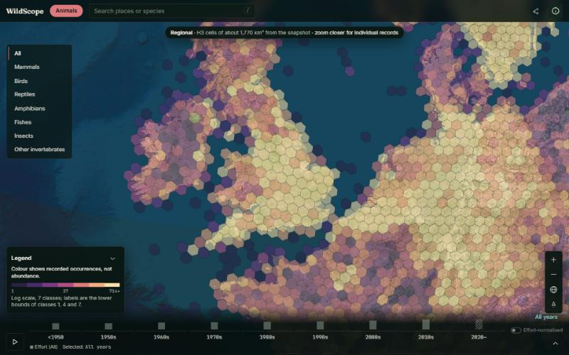 **Regional:** H3 res-4 cells over Britain |
| 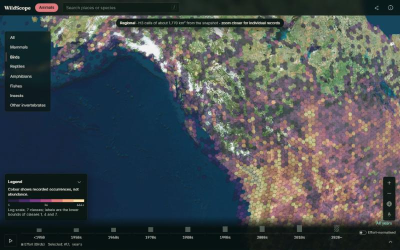 **Group filter:** Birds only, British Columbia |  **Local:** birds around Lahore (6,582 records in view) |
| 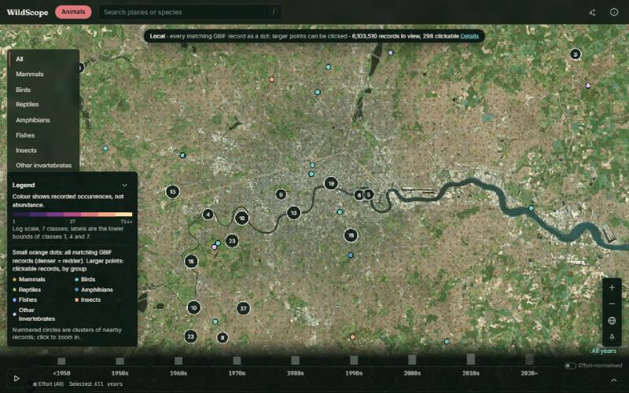 **Density dots and clusters:** London (6,103,510 records in view) | 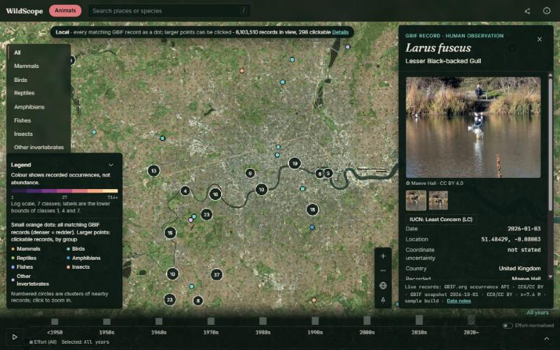 **Record card:** *Larus fuscus*, CC BY 4.0 photo with credit |
| 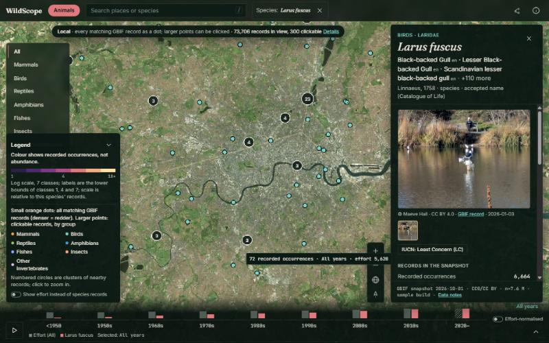 **Species mode:** names, photo, IUCN, records by decade beside effort | 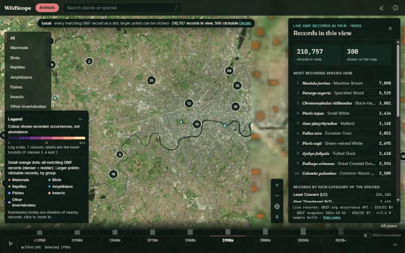 **Records in view, 1990s:** top species and IUCN categories |
| 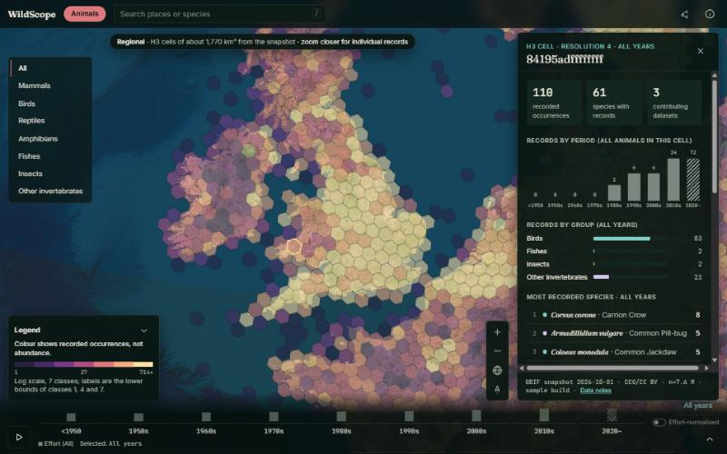 **Cell summary:** 110 records, 61 species, 3 datasets (sample build) | 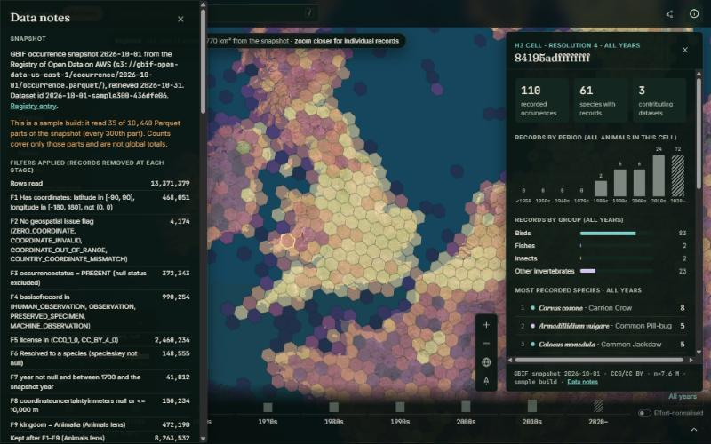 **Data notes:** every filter stage with its count |
| 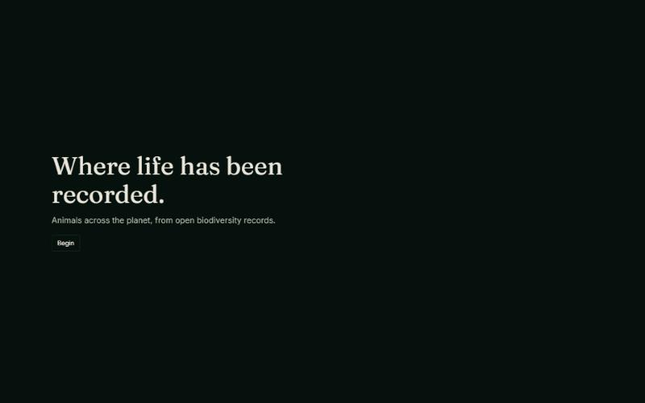 **Opening screen** while the globe loads | 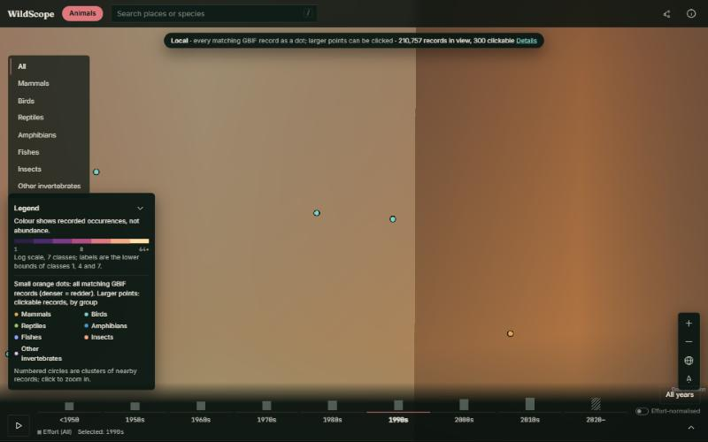 **Progressive loading:** records arrived, imagery still sharpening |

A recorded demo video does **not** exist yet; [docs/demo-script.md](docs/demo-script.md) has the script and shot list.

## Dataset

| | |
|---|---|
| Source | GBIF occurrence snapshot, `s3://gbif-open-data-us-east-1/occurrence/2026-10-01/occurrence.parquet/` (Registry of Open Data on AWS) |
| Size (verified in build step 0) | 10,448 Parquet parts, 303.0 GB |
| Licences used | CC0 1.0 and CC BY 4.0 records only (CC BY-NC excluded) |
| Taxonomy | Species keys in this snapshot are Catalogue of Life eXtended Release ids (e.g. `93Q3Q`); names come from Catalogue of Life via ChecklistBank (CC BY 4.0) |
| **Deployed build** | **Sample build:** 35 of the 10,448 parts (every 300th), 13,371,379 rows read, 7,591,556 records counted, 3,217 species files, 2,211 region files. Dataset id `2026-10-01-sample300-436dfe06`. |
| Live data | The local level, record cards, photos, IUCN categories and "records in view" query the GBIF API (`api.gbif.org`) at request time |

Because the deployed snapshot figures come from a **0.3% file sample**, cell and species counts are
partial; the app says so in Data notes and in every cell panel. The live GBIF layers are not sampled.

## Data processing and filtering

The pipeline (`pipeline/wildscope/build.py`, Python + DuckDB + H3) reads the Parquet files in place and
records how many rows each rule removes. Figures below are from the deployed sample build's manifest.

| Rule | Removed in the sample build |
|---|---:|
| F1 coordinates present, in range, not (0, 0) | 468,051 |
| F2 no GBIF geospatial issue flag | 4,174 |
| F3 `occurrenceStatus = PRESENT` | 372,343 |
| F4 basis: human / machine / unspecified observation or preserved specimen (fossils, living collections and material samples excluded) | 990,254 |
| F5 licence CC0 or CC BY 4.0 | 2,460,234 |
| F6 resolved to a species | 148,555 |
| F7 year between 1700 and the snapshot year | 41,812 |
| F8 coordinate uncertainty unknown or ≤ 10 km | 150,234 |
| F9 kingdom Animalia | 472,190 |
| D1 duplicates: same species, coordinates (5 dp) and date counted once | 671,976 |
| **Records counted** | **7,591,556** |

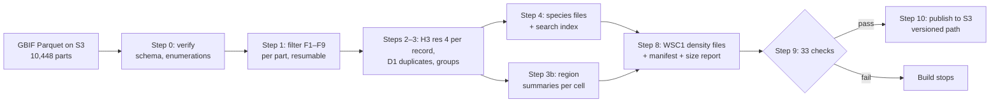

The live layers apply the same licence, presence, coordinate and basis rules through GBIF API
parameters. F8 is applied in the browser, because GBIF's uncertainty filter would also drop records that
state no uncertainty (see [Error handling](#error-handling-and-retries) and [docs/architecture.md](docs/architecture.md)).

## Architecture

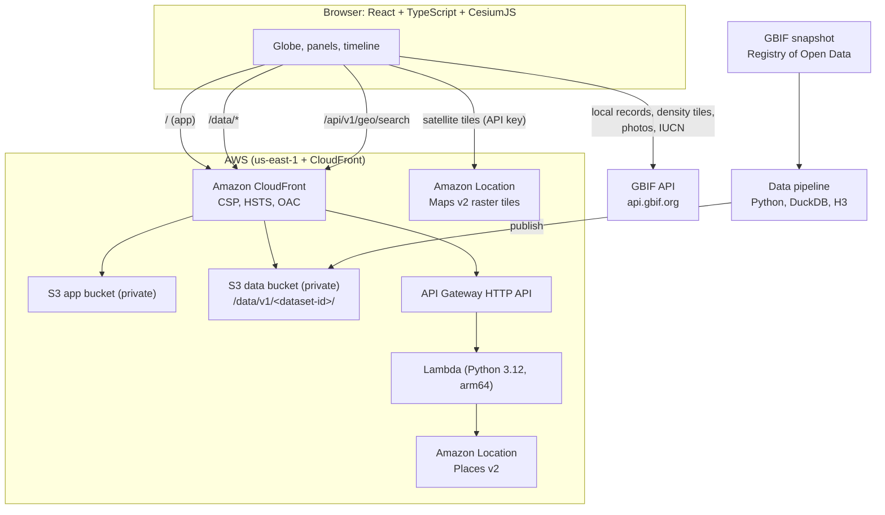

The globe's main path is static files: the app and snapshot aggregates come from CloudFront, and the
only server-side code is the place-search Lambda. Full detail, including the request sequence for the
local zoom level, is in [docs/architecture.md](docs/architecture.md).

## AWS services

Every service below is defined in `infra/wildscope.yaml` and was deployed to account `159412676011`
(us-east-1) with `scripts/deploy.sh`.

| Service | Responsibility in WildScope |
|---|---|
| **Registry of Open Data on AWS** (S3) | Source of the GBIF snapshot, read in place by DuckDB over S3 |
| **Amazon Location Service** | **Maps v2** raster satellite tiles as the globe's basemap (API key restricted to `geo-maps:GetTile` and the site's referrer); **Places v2** `SearchText` for place search, called from Lambda with IAM so no key is exposed |
| **Amazon S3** | Private app, data and build buckets; Block Public Access, SSE-S3, TLS-only bucket policies |
| **Amazon CloudFront** | One distribution with Origin Access Control for both buckets, an `/api/*` behaviour to API Gateway, and a response-headers policy (CSP, HSTS, X-Frame-Options, Referrer-Policy, Permissions-Policy) |
| **Amazon API Gateway** (HTTP API) | Routes `GET /api/v1/health` and `GET /api/v1/geo/search`; stage throttling (burst 50, 25 req/s) |
| **AWS Lambda** | Python 3.12 on arm64, 512 MB, 10 s timeout: input validation, Places v2 call, error mapping |
| **Amazon CloudWatch** | Lambda and API access logs (14-day retention); alarm on API 5xx responses |
| **AWS Budgets** | Monthly cost budget with email alerts at 50%, 80% and 100% |
| **AWS IAM** | Least-privilege Lambda role (`geo-places:SearchText` on the provider resource, logs) |
| **AWS CloudFormation** (+ SAM transform for packaging) | The whole stack |
| **Amazon EC2** (template only) | `infra/build-job.yaml` defines a self-terminating instance for the full-snapshot build. **It has not been deployed.** |

## Technical stack

| Layer | Technology |
|---|---|
| Frontend | React 19, TypeScript 6, Vite 8, CesiumJS 1.146, h3-js, zustand, spark-md5; fonts self-hosted via @fontsource |
| Data pipeline | Python 3.13 (3.12 on EC2), DuckDB 2.0 with the `h3` community extension, h3 (Python), PyYAML, jsonschema, brotli, boto3 |
| API | Python 3.12 Lambda, boto3 `geo-places` |
| Infrastructure | CloudFormation (SAM transform), Bash deploy script, Makefile |
| Tests | vitest, Python unittest, pipeline step 9, ESLint, TypeScript, pyflakes, cfn-lint, custom wording lint and CSP check |

## Data versioning and caching

- Every data build gets a **content-versioned dataset id** (`<snapshot>-<sample>-<hash of all assets>`,
  e.g. `2026-10-01-sample300-436dfe06`) and is published under `/data/v1/<dataset-id>/`. Files there are
  never overwritten, so they are served with `Cache-Control: public, max-age=31536000, immutable`.
- `/data/v1/latest.json` (5-minute cache) points to the current dataset and is the only path invalidated
  on publish.
- Density files are pre-compressed with **brotli**, JSON with **gzip**, and served with `Content-Encoding`.
  The sample build's initial density payload is **163,019 bytes** (brotli; budget 6 MB, from the manifest's
  size report).
- Share links carry the dataset id (`snap=`), so a link reopens the data it was made with.
- The app shell (`index.html`, `config.json`) is served with `no-cache`; hashed JS/CSS assets are immutable.

This replaced an earlier scheme that reused one path per snapshot: after a rebuild, CloudFront and
browsers mixed old and new files and the density layer failed to load in some areas (fixed 2026-10-31).

## Error handling and retries

| Situation | Behaviour |
|---|---|
| Static file fails | Up to 3 attempts with backoff (2 s, 4 s), then a banner with a **Retry** that re-runs the load |
| GBIF API: dropped connection, 429 or 5xx | One automatic retry after 1.5 s, then "GBIF did not answer · Retry" in the status bar; the globe keeps working |
| GBIF photo not generated yet | GBIF's image cache can fail the first request for a new size: one retry after 1.5 s, then the photo is dropped instead of showing a broken image |
| Amazon Location tiles fail repeatedly | After 6 errors the basemap switches to Natural Earth imagery bundled with CesiumJS, with a message |
| Place-search Lambda | Validates input (400), maps throttling to 429 with `Retry-After`, other dependency failures to 503; results `no-store` |
| WebGL | No WebGL2 → explanatory page; a render error shows a banner; a canvas collapsed to 0 px recovers on the next resize |
| View rectangle | If Cesium reports an implausible view (before the first frame, horizon tilt, antimeridian) the live query uses a box around the camera instead |
| Coordinate uncertainty (F8) | GBIF's interval filter drops records with no stated uncertainty (97% of records around Lahore), so live queries omit it; records stating > 10 km are removed in the browser and subtracted from totals with a second count |

## Installation and local development

Requirements: Python 3.12 or 3.13, Node.js 20+, Git Bash/WSL/macOS/Linux, and `make` (optional; every
target is a plain command).

```bash
git clone <this-repo> wildscope && cd wildscope
python -m venv .venv
.venv/Scripts/python -m pip install -r pipeline/requirements.txt pyflakes cfn-lint   # use .venv/bin/python on macOS/Linux
npm --prefix web ci
```

Build the sample data (reads 35 GBIF parts from the public bucket; no AWS account needed):

```bash
.venv/Scripts/python -u -m pipeline.wildscope.build all --snapshot 2026-10-01 --sample-every 300 --threads 8 --parallel 4
```

Run the app at http://localhost:5173 (the dev server serves `pipeline/out` at `/data/v1/`):

```bash
npm --prefix web run dev
```

Without a `web/public/config.json`, the globe uses the bundled Natural Earth imagery and place search
reports "unavailable"; everything else (snapshot layers, live GBIF records, photos) works locally. To use
the deployed place search, start the dev server with `WILDSCOPE_API=https://<distribution>` set.

## Environment variables

| Variable | Used by | Purpose |
|---|---|---|
| `BUDGET_EMAIL` (required) | `scripts/deploy.sh` | Address for AWS Budgets alerts |
| `AWS_PROFILE`, `AWS_REGION` | deploy, publish | Credentials and region (`us-east-1`) |
| `STACK`, `ENV_NAME` | deploy | Stack name (`wildscope-prod`) and environment tag (`prod`) |
| `BUDGET_USD` | deploy | Monthly budget ceiling (default 20) |
| `PY` | deploy, Makefile | Python interpreter (e.g. `.venv/Scripts/python`) |
| `SKIP_DATA` | deploy | `1` deploys stack and app without re-publishing data |
| `WILDSCOPE_API` | Vite dev server | Proxy `/api` to a deployed distribution |
| `SNAPSHOT`, `SAMPLE_EVERY`, `C`, `REPO_URL` | Makefile | Snapshot id, sample stride, country code for a country slice, repo URL for the EC2 build job |
| `DATASET_ID`, `PLACES_ATTRIBUTION` | Lambda (set by CloudFormation) | Reported in API responses / shown with place results |

Runtime browser configuration is `config.json` (`apiBase`, `locationApiKey`, `locationRegion`,
`placesAttribution`). The deploy script writes it to the app bucket with the Amazon Location key read
from AWS; it is **git-ignored** and never committed.

## Deployment

Needs AWS CLI v2 with credentials (an `aws login` session works) for an account where you can create IAM
roles, in us-east-1.

```bash
BUDGET_EMAIL=you@example.com PY=.venv/Scripts/python bash scripts/deploy.sh
```

The script: creates an artifacts bucket if needed → packages the Lambda and deploys
`infra/wildscope.yaml` → builds the web app → writes `config.json` with the Maps key → uploads the app →
publishes the latest data build (step 10 refuses to publish if step 9 failed) → invalidates
`index.html`, `config.json` and `latest.json`. The same is available as `make deploy BUDGET_EMAIL=…`.

Full-snapshot data (runs in us-east-1 next to the data; the repository must be public):

```bash
make data-aws REPO_URL=https://github.com/<you>/<repo>.git
```

## Testing and validation

Results from the latest run on 2026-11-01 (commands in [docs/REVIEW.md](docs/REVIEW.md)):

| Check | Result |
|---|---|
| Pipeline step 9 on the deployed build: SHA-256 checksums, JSON Schemas (manifest, species, search, region), filter-stage sums, 200 random cells recomputed independently in Python with the duplicate rule re-implemented, res-2 = Σ res-4, species totals, region files = density files, a region file for every populated cell | **33/33 pass** |
| Web unit tests (vitest): WSC1 decoding, zoom levels and hysteresis, legend classes, species ranking, live query filters, licence normalisation, photo URLs, record mapping, group mapping, number formatting | **15/15 pass** |
| Lambda unit tests (stubbed Amazon Location) | **4/4 pass** |
| ESLint + wording lint (forbidden words such as "extinct", "vanished", "range") + TypeScript | pass |
| pyflakes, cfn-lint, CSP consistency (app = CloudFront) | pass |
| Live checks: `/`, `/api/v1/health`, `/api/v1/geo/search?q=Lahore` → "Lahore, Pakistan", every density file's SHA-256 matches its manifest (16/16), security headers present | pass |
| Manual browser tests (zoom levels, groups, species mode, record cards, cell panel, timeline filter, Data notes, phone width, production build under the production CSP) | pass; bugs found and fixed are listed in [docs/REVIEW.md](docs/REVIEW.md) |

Not done: automated end-to-end browser tests, accessibility audit with a screen reader, load tests, and
measured frame rates.

## Performance and known limitations

- **Sample data.** Snapshot-based figures (cells, cell panels, species files) cover 35 of 10,448 parts.
  The full build (`make data-aws`) has not been run.
- **Trees** are not included (no settled tree list).
- **Live counts and snapshot counts differ by design** (today's GBIF index vs. a dated, sampled snapshot);
  each is labelled and they are never added together.
- **Slow counts in dense areas.** GBIF can take up to about 30 seconds to count millions of records
  (observed over London); the globe stays usable while it loads.
- **At most 300 clickable records** per view; the density dots show all matching records, snapped to the
  map tile's pixel grid.
- The density dots cannot apply the 10 km uncertainty rule (GBIF limitation); "Other invertebrates" has
  no single GBIF taxon key, so only clickable points are shown for that group.
- **Not shown** because there is no verified source: habitat, life cycle, native/introduced status beyond
  what a record states, IUCN assessment years, and the imagery's capture date.
- The CSP allows `'unsafe-eval'` for scripts from this origin only, because CesiumJS bundles Knockout.
- Per-IP rate limits need AWS WAF, which is not deployed; the API stage is throttled instead.
- JavaScript bundle is about 1.3 MB gzipped (mostly CesiumJS).

## Future improvements

- Run the full-snapshot build in us-east-1 and publish it.
- Add Trees once a licensed tree list (e.g. BGCI GlobalTreeSearch, terms permitting) is in place.
- Polygon and country summaries; compare two periods or two species side by side.
- Automated end-to-end tests (e.g. Playwright) and an accessibility audit.
- AWS WAF rate limits if traffic grows; CI/CD with GitHub Actions and OIDC.

## License and acknowledgements

- Code: [MIT](LICENSE). Derived aggregate data files: CC BY 4.0.
- **GBIF.org**: occurrence data (CC0 and CC BY 4.0 records only); the snapshot citation is shown in
  Data notes. GBIF API and image cache for live records and photos; each photo is credited to its creator
  under its own licence.
- **Catalogue of Life** via ChecklistBank: names (CC BY 4.0).
- **Amazon Location Service**: basemap and place search (data-provider terms apply).
- **Natural Earth**: fallback imagery bundled with CesiumJS.
- CesiumJS, H3, h3-js (Apache-2.0); DuckDB, React, Vite, zustand (MIT); Fraunces, Inter, JetBrains Mono
  (SIL OFL). Full list: [THIRD_PARTY_NOTICES.md](THIRD_PARTY_NOTICES.md).
