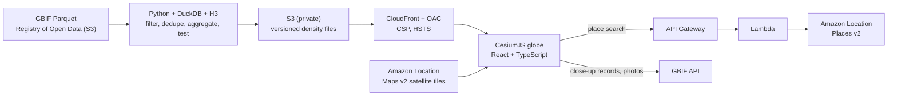
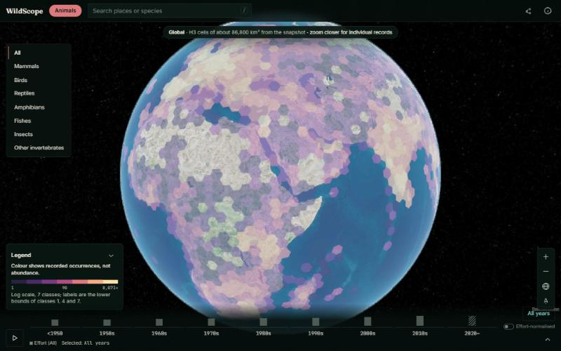
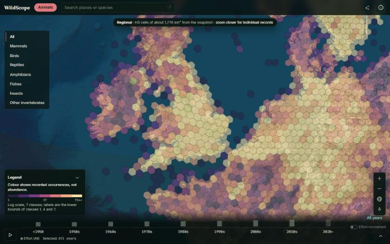
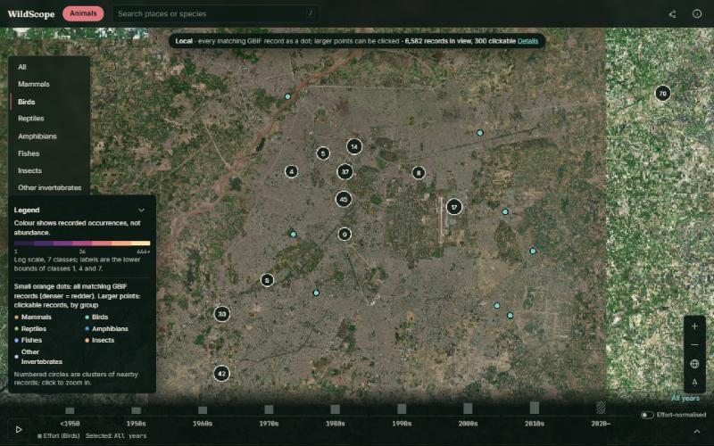
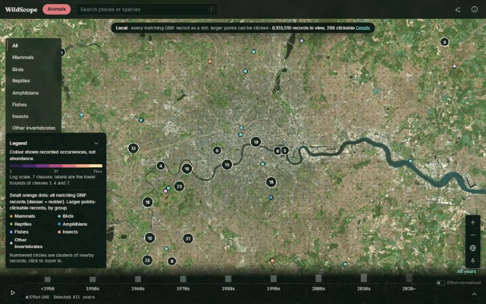
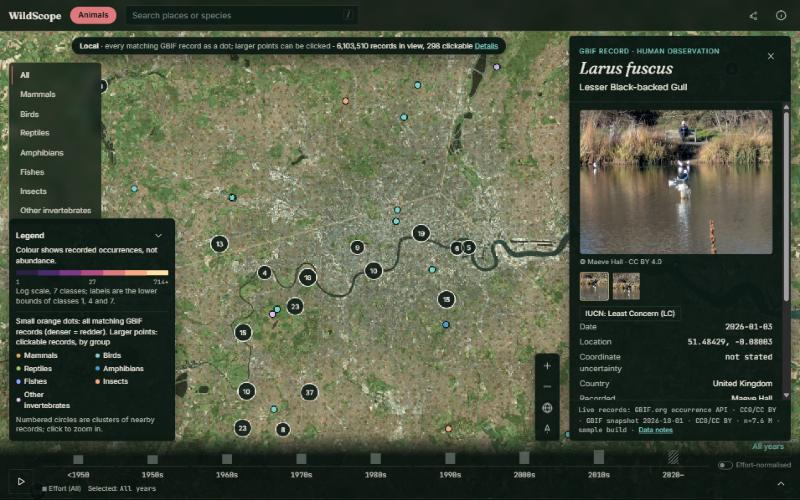
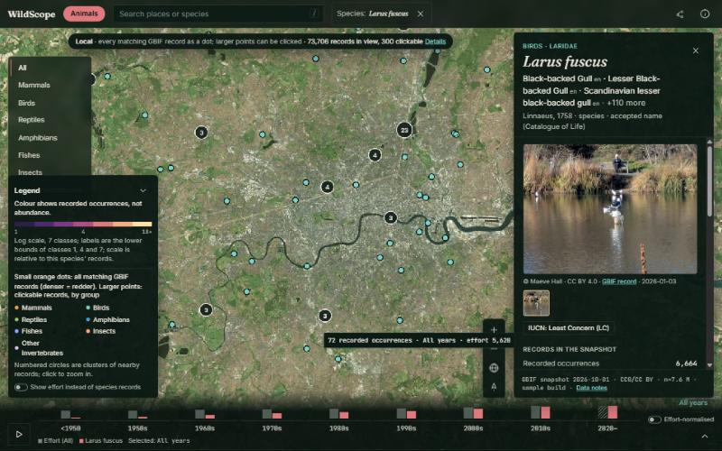
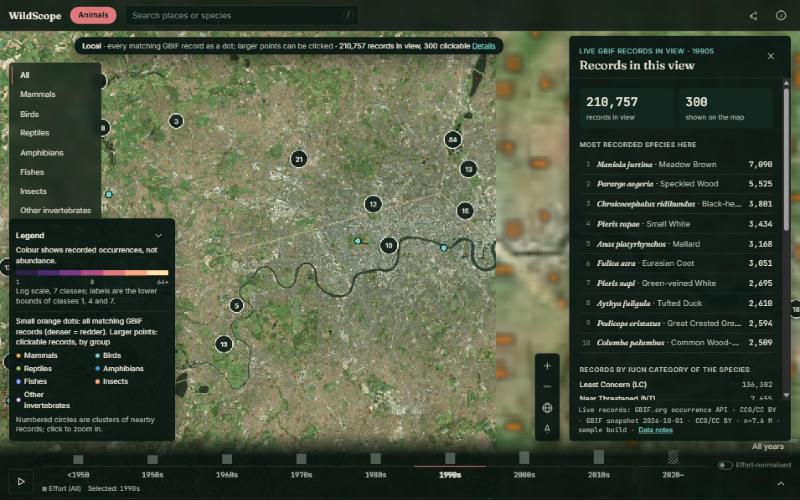
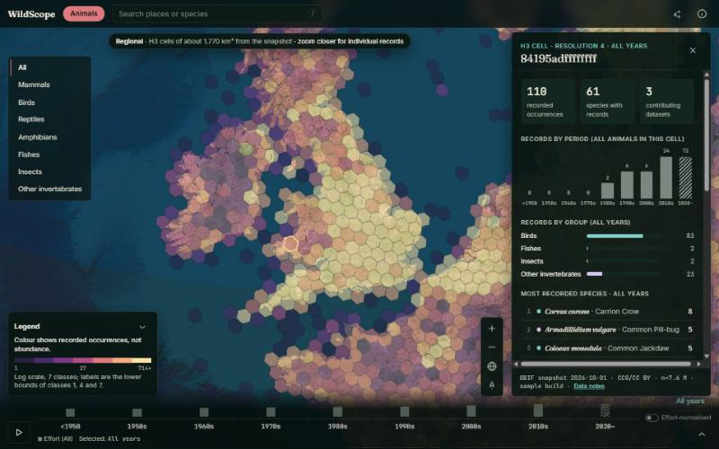

# WildScope — submission for AWS Builder Center "Weekend Challenge: Map it"

**From the planet to a single observation: a 3D globe of where animals have been recorded, built on the
GBIF snapshot in the Registry of Open Data on AWS and Amazon Location Service.**

| | |
|---|---|
| Live map (AWS) | https://d2za8aq0bl0uib.cloudfront.net |
| Live map (Vercel mirror, same app and data) | https://wildscope.vercel.app |
| Public code | https://github.com/SYMOIZ/wildscope (MIT) |
| Demo video (< 3 min) | **[ADD YOUTUBE/VIMEO LINK BEFORE SUBMITTING]** (script: [demo-script.md](docs/demo-script.md)) |
| Dataset | GBIF occurrence snapshot `2026-10-01`, `s3://gbif-open-data-us-east-1/` (Registry of Open Data on AWS) |
| AWS services | Amazon Location Service (Maps v2 + Places v2), Amazon S3, Amazon CloudFront, Amazon API Gateway, AWS Lambda, Amazon CloudWatch, AWS Budgets, AWS IAM, AWS CloudFormation |

All figures in this document were measured on the live site or in the build manifest on 2026-10-31 and
2026-11-01. Live GBIF counts change daily.

---

## 1. Copy-paste text for the submission form

**Title:** WildScope: where animals have been recorded, from planet to single observation

**One-line summary:** A 3D globe that turns the 303 GB GBIF snapshot on AWS into an explorable map,
from global H3 hexagons down to individual photographed observations, on Amazon Location satellite
imagery.

**Dataset (what it is and what is in it):** The GBIF occurrence snapshot of 2026-10-01 from the
Registry of Open Data on AWS: 10,448 Parquet files, 303 GB, each row one recorded observation or
specimen with coordinates, coordinate uncertainty, date, species, licence and basis of record. WildScope
uses only CC0 and CC BY 4.0 animal records, after nine documented quality filters and a duplicate rule.
Close-up views query GBIF's live API with the same filters, for individual records and photos.

**How it is on the map, and which AWS service and why:** Amazon Location Service is the map. Maps v2
raster satellite tiles are the basemap inside a CesiumJS 3D globe, through an API key restricted to
tile requests from the site's own address. Places v2 powers place search from a Lambda behind API
Gateway, using IAM, so no search key ever reaches the browser. On top of the imagery, a Python, DuckDB
and H3 pipeline reads the GBIF Parquet files directly from S3 and publishes compact, versioned density
files to S3 behind CloudFront. Above 1,200 km you see H3 hexagons; below that you see every matching
record as a density dot, plus clickable, clustered records with dates, licences and photos. Amazon
Location was chosen because it gives satellite imagery and geocoding from the same AWS account as
the data, with IAM and key restrictions instead of third-party map keys.

**What people can explore:** Zoom from the whole planet to a city; filter by animal group and decade;
click a record to see species, date, accuracy, recorder, licence and a credited photo; open a species
to see it worldwide; click any hexagon for records, species, datasets and change over time; read
exactly how many records each quality rule removed.

---

## 2. Entry requirements — checklist with evidence

| Requirement (from the rules) | Status | Evidence |
|---|---|---|
| The dataset you started with and what is in it | ✅ | §1, §4, [README "Dataset"](README.md#dataset), Data notes panel in the app |
| How you put it on the map, the AWS location or data service used and why | ✅ | §1, §5, [architecture.md](docs/architecture.md) |
| At least one AWS service in the app or data pipeline | ✅ | Nine AWS services, all in [`infra/wildscope.yaml`](infra/wildscope.yaml), deployed to us-east-1 |
| Link to the live map | ✅ | https://d2za8aq0bl0uib.cloudfront.net (and https://wildscope.vercel.app) |
| Public code repository (encouraged) | ✅ | https://github.com/SYMOIZ/wildscope |
| Short (< 3 min) public demo video in the "demo" field | ⚠️ **To do** | Script and shot list ready: [demo-script.md](docs/demo-script.md) |
| Previously unpublished project | Entrant to confirm | First commit 2026-10-31, during the challenge window |
| Real dataset you have the right to use; nothing personal or sensitive | ✅ | Public GBIF data; CC0/CC BY records only; photos only when the image is CC0/CC BY, credited; no personal data collected |

---

## 3. What the map reveals (the story)

**Records are not animals.** WildScope's central idea is that occurrence data shows *where people have
looked*, and a good map should make that visible instead of hiding it. Every layer says what it counts
and where the number comes from, and sampling effort is shown next to every species count.

Things you can find in a few clicks (live counts on 2026-11-01):

- **Lahore:** 6,582 bird records in a city-scale view, mostly observations without a stated coordinate
  accuracy. A naive filter that requires stated accuracy (GBIF's own interval filter) would have kept
  **215 of 8,245** animal records in that area, hiding **97%** of Lahore's data. WildScope keeps records
  with unknown accuracy, as the build does, and removes only those that state more than 10 km.
- **London in the 1990s:** the two most recorded species in view are butterflies (Meadow Brown: 7,090
  records; Speckled Wood: 5,525), ahead of every bird. That says what was recorded, not what lived
  there: switch decades and the mix changes with who was recording, which the effort strip shows.
- **Duplicates are real:** the same animal at the same spot on the same day is often published by more
  than one dataset. WildScope's duplicate rule removed **671,976** of 8,263,532 kept records (8.1%) in
  the deployed build.
- **One photographed gull, then the world:** click a Lesser Black-backed Gull record in London, see the
  observer's CC BY photo, then open the species and see all its records worldwide, by decade.

---

## 4. Dataset and data processing

| | |
|---|---|
| Source | `s3://gbif-open-data-us-east-1/occurrence/2026-10-01/occurrence.parquet/`, 10,448 Parquet parts, 303.0 GB (verified by the pipeline's step 0) |
| Deployed build | Sample of 35 parts (every 300th): 13,371,379 rows read, **7,591,556 records counted**, 3,217 species files, 2,211 cell-summary files |
| Live layers | GBIF occurrence API, maps API and image cache, queried with the same filters |
| Names | Catalogue of Life via ChecklistBank (CC BY 4.0) |

Quality filters, each with its recorded drop count (from the build manifest):

| Rule | Removed |
|---|---:|
| F1 valid coordinates (not 0,0) | 468,051 |
| F2 no GBIF geospatial issue | 4,174 |
| F3 status PRESENT | 372,343 |
| F4 observations and preserved specimens only (no fossils, zoos or material samples) | 990,254 |
| F5 licence CC0 or CC BY 4.0 | 2,460,234 |
| F6 resolved to species | 148,555 |
| F7 year 1700 to snapshot year | 41,812 |
| F8 coordinate uncertainty unknown or ≤ 10 km | 150,234 |
| F9 animals only | 472,190 |
| D1 duplicates (same species, coordinates to 5 dp, date) | 671,976 |

The pipeline's step 0 found that the snapshot differs from GBIF's documented download schema (no
`hasCoordinate`/`hasGeospatialIssues` columns, Catalogue of Life species keys, bony fishes under class
`Teleostei`) and adapted the filters and groups. Step 9 runs 33 checks, including an **independent
recount of 200 random cells** from raw coordinates; publishing refuses to run if any check fails.

---

## 5. How the pieces fit (reusable pattern)

Patterns another builder can lift directly:

1. **Amazon Location satellite tiles in CesiumJS.** One `UrlTemplateImageryProvider` pointing at
   `https://maps.geo.us-east-1.amazonaws.com/v2/tiles/raster.satellite/{z}/{x}/{y}?key=…` with a Web
   Mercator tiling scheme. The key is created in CloudFormation (`AWS::Location::APIKey`), restricted
   to `geo-maps:GetTile` and the site's referrer, and written to a runtime `config.json` at deploy time,
   never committed. Code: `web/src/globe/Globe.tsx`, `infra/wildscope.yaml`.
2. **Geocoding without a browser key.** Places v2 `SearchText` from a Lambda whose IAM role allows only
   `geo-places:SearchText`; strict input validation; results `no-store`. Code: `lambda/geo/handler.py`.
3. **Querying a 303 GB public Parquet dataset in place** with DuckDB over S3, resumable per file.
   Code: `pipeline/wildscope/build.py`.
4. **Immutable caching that is safe to update:** every build gets a content-hashed dataset id, files are
   cached for a year, only `latest.json` is short-lived. This replaced an earlier scheme after it caused
   mixed old/new files in production.
5. **Two kinds of data on one map, never mixed:** a dated, tested snapshot for aggregates; GBIF's live
   API for close-ups. Each number on screen names its source.

Deploy: `bash scripts/deploy.sh` (CloudFormation, app, data) and `bash scripts/deploy-vercel.sh` (mirror).

---

## 6. Judging criteria — how WildScope addresses each

### Technical innovation and originality (25%)

- The map changes **what kind of data it shows** as you zoom, not just its resolution: H3 aggregates
  from a tested snapshot above 1,200 km; every matching live record as density dots plus clustered,
  clickable records below.
- H3 hexagons are rasterised per map tile in a custom Cesium imagery provider, with clicks resolved
  through h3-js, so tens of thousands of cells draw without uploading polygon geometry.
- A compact binary format for density files (nine time periods per cell) and content-versioned dataset
  paths.
- Amazon Location used in two ways at once: satellite tiles in a 3D globe, and IAM-secured geocoding.

### Craft and execution (25%)

- **Reliability work:** tile retries and a basemap fallback that triggers only when imagery really fails;
  GBIF request retries; rendering recovery; a graceful no-WebGL page.
- **Validation:** 33 data checks, 19 frontend unit tests, 4 Lambda tests, ESLint, TypeScript, cfn-lint,
  a security-header consistency check, and a wording lint that enforces the honesty rules.
- **Security:** private S3 behind Origin Access Control, verified CSP/HSTS/X-Frame-Options/Referrer-
  Policy headers, a referrer- and action-restricted map key, API throttling, a 5xx alarm and a budget.
- **Production bugs fixed at the root**, each documented in [REVIEW.md](docs/REVIEW.md): stale mixed caches,
  a 97% data loss from an accuracy filter, a WebGL context leak, an over-sensitive basemap fallback.

### Usefulness and impact (25%)

- Anyone can see which animals people have recorded near them, when and by whom, with photos credited
  to their creators.
- Analytics from real data at every level: cell summaries (records, species, datasets, decades, groups,
  top species, data coverage) and live "records in view" (top species, IUCN categories, classes).
- Fully reusable: MIT code, CloudFormation, one-command deploy, documented architecture
  ([architecture.md](docs/architecture.md)) and the patterns in §5.

### Creativity and storytelling (25%)

- One continuous journey on one globe: planet → region → city → one photographed observation → that
  species worldwide → back through the decades.
- The honest framing is part of the design: the legend says "not abundance", empty cells are never
  "absence", falls between decades are described as "fewer records" beside the effort bars, and a
  build-time lint blocks wording that claims more than the data shows.
- Natural-colour satellite imagery with translucent data, so place and pattern stay readable together.

---

## 7. Screenshots (all captured from the live site)

| | |
|---|---|
|  Global H3 cells |  Regional cells over Britain |
|  Birds around Lahore |  London: density dots and clusters |
|  Record card with credited photo |  Species mode |
|  Records in view, 1990s |  Cell summary |

---

## 8. Honest limitations

- The deployed snapshot layers come from a **0.3% file sample** (35 of 10,448 parts); the live close-up
  layers are complete. A full build is scripted (`make data-aws`) but has not been run.
- Trees are not included: there is no settled, licensed list of which plants are trees.
- GBIF can take up to about 30 seconds to count millions of records in dense areas such as London.
- No habitat, life-cycle or population claims: there is no verified source for them, and records are
  not population counts.

## 9. Attribution

GBIF.org (CC0 and CC BY 4.0 records; snapshot citation in the app's Data notes) · Catalogue of Life via
ChecklistBank (CC BY 4.0) · Amazon Location Service (data-provider terms apply) · Natural Earth
(fallback imagery) · CesiumJS, H3, h3-js (Apache-2.0) · DuckDB, React, Vite (MIT). Full list:
[THIRD_PARTY_NOTICES.md](THIRD_PARTY_NOTICES.md).
