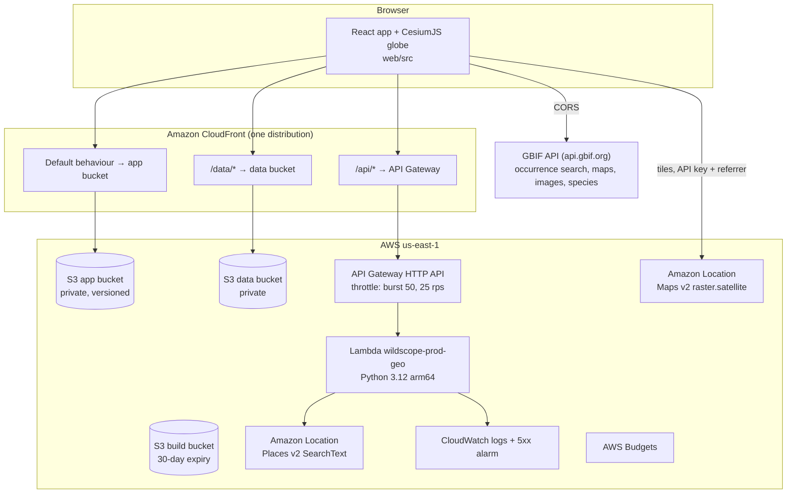
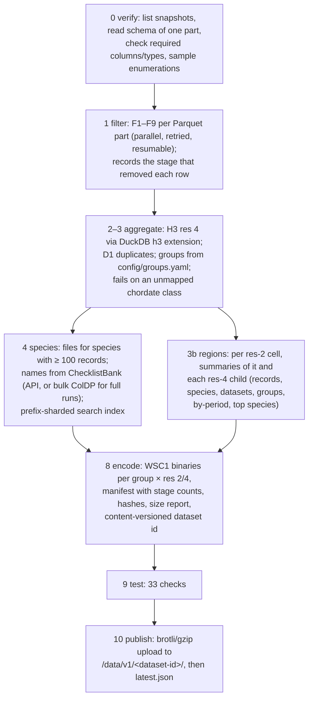
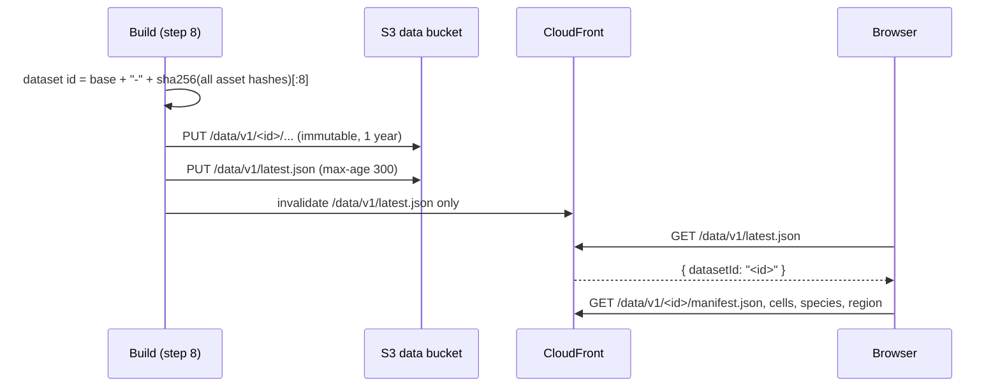
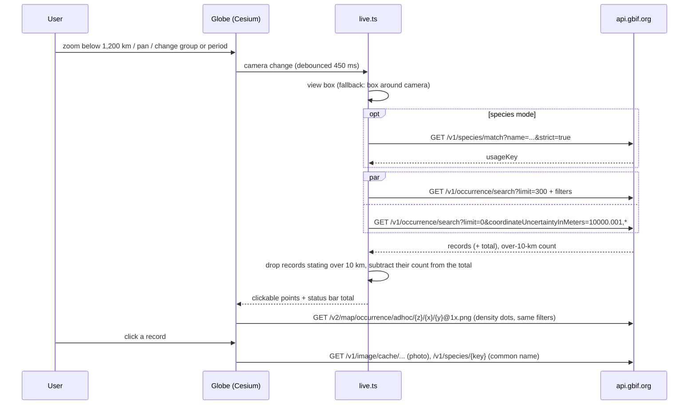
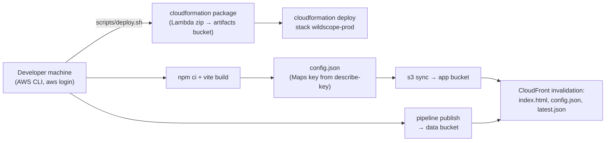

# WildScope architecture

Everything here is taken from the repository (`infra/`, `lambda/`, `pipeline/`, `web/`, `scripts/`) and
from the deployment made with `scripts/deploy.sh` on 2026-10-31/11-01. Source file references are given
so each statement can be checked.

## 1. System overview

| Path | What travels over it | Code |
|---|---|---|
| `/` | `index.html`, hashed JS/CSS, fonts, Cesium assets (`/cesium/*`), `config.json` | `web/vite.config.ts`, `scripts/deploy.sh` |
| `/data/v1/…` | `latest.json`, manifest, WSC1 density files, species, search and region JSON | `web/src/data/assets.ts` |
| `/api/v1/health`, `/api/v1/geo/search` | Place search | `lambda/geo/handler.py`, `web/src/components/SearchBox.tsx` |
| `maps.geo.us-east-1.amazonaws.com` | Satellite basemap tiles (Web Mercator XYZ) | `web/src/globe/Globe.tsx` (`makeBasemap`) |
| `api.gbif.org` | Live records, density tiles, photos, species match, IUCN category | `web/src/data/gbif.ts` |

## 2. AWS infrastructure (`infra/wildscope.yaml`)

| Resource | Configuration |
|---|---|
| `AppBucket`, `DataBucket`, `BuildBucket` | Block Public Access, SSE-S3 (AES256), bucket-owner-enforced; app bucket versioned (old versions expire after 30 days); build bucket objects expire after 30 days |
| `OriginAccessControl` + bucket policies | CloudFront-only `s3:GetObject`, scoped by distribution ARN; deny non-TLS access |
| `SecurityHeaders` (response headers policy) | CSP (identical to `web/src/csp.ts`, checked by `scripts/check_csp.py`), HSTS 1 year, X-Content-Type-Options, X-Frame-Options DENY, Referrer-Policy, Permissions-Policy |
| `Distribution` | HTTP/2+3, IPv6, PriceClass_100; behaviours: default → app (CachingOptimized), `/data/*` → data (CachingOptimized, no recompression), `/api/*` → API (CachingDisabled, AllViewerExceptHostHeader) |
| `HttpApi`, `ApiStage`, routes, integration | HTTP API, `$default` stage with throttling and JSON access logs; CORS only for `http://localhost:5173` (the app calls the API same-origin) |
| `GeoFunction` (SAM) + `GeoFunctionRole` | Python 3.12, arm64, 512 MB, 10 s; role allows `logs:CreateLogStream`/`logs:PutLogEvents` on its own log group and `geo-places:SearchText` on `arn:aws:geo-places:us-east-1::provider/default` |
| `MapsApiKey` (`AWS::Location::APIKey`) | Allows only `geo-maps:GetTile` on the provider resource; allowed referrers: the CloudFront domain, `localhost:5173`, `localhost:4173`; no expiry |
| `ApiErrorsAlarm` | API Gateway 5xx ≥ 5 in 3 of 5 minutes |
| `MonthlyBudget` | Cost budget (default USD 20) with email at 50/80/100% |

A `Rules` assertion keeps the stack in us-east-1, where the CSP allows the Amazon Location tile host.

`infra/build-job.yaml` defines an optional EC2 build job (instance profile limited to `s3:PutObject` on
`data/v1/*` and one CloudFront invalidation, shutdown-to-terminate, hard stop after N hours). It has
**not** been deployed.

## 3. Data ingestion and processing (`pipeline/wildscope/build.py`)

Key facts:

- Step 0 found that this snapshot has no `hascoordinate`, `hasgeospatialissues` or `datageneralizations`
  columns, that species keys are Catalogue of Life ids, and that bony fishes appear as class `Teleostei`.
  The spec was corrected accordingly (`wildscope-product-blueprint/DATA_ARCHITECTURE.md` §14).
- **WSC1** density format (little-endian): magic `WSC1`, version, resolution, group index, cell count,
  H3 ids as two `uint32` arrays, then nine `uint32` counts per cell (one per period).
- Step 9 recomputes 200 random cells **independently** (Python `h3` on raw coordinates, duplicate rule
  re-implemented) and compares them with the decoded binaries; publishing refuses a failed report.
- Re-running with the same inputs gives byte-identical data files (checked 2026-10-31).

Compute: the deployed sample was built on a workstation. Bandwidth from outside us-east-1 makes a full
or country-filtered run impractical there (parts are grouped by dataset, with no column statistics), so
the full run is designed for EC2 in us-east-1.

## 4. Dataset versioning

Because a path is never reused, cached copies can never mix two builds. The URL keeps the id
(`snap=`), so shared links reopen the same data while it exists.

## 5. Frontend and backend communication

### Zoom levels (`web/src/globe/lod.ts`, `web/src/config/interaction.ts`)

| Level | Camera height | Drawn | Source |
|---|---|---|---|
| Global | ≥ 8,000 km | H3 res 2 cells, 62% opacity | `cells/animals/<group>/r2.bin` |
| Regional | 1,200–8,000 km | H3 res 4 cells with thin edges, 55% | `r4.bin` |
| Local | < 1,200 km | Res 4 outlines (35%), GBIF density dots, up to 300 clickable records (Cesium entity clustering, 36 px) | GBIF API |

Cells are rasterised per map tile by a custom Cesium imagery provider (`web/src/globe/cellLayer.ts`);
picking uses h3-js on the clicked coordinate, so no polygon geometry is uploaded.

### Local level request sequence (`web/src/state/live.ts`, `web/src/data/gbif.ts`)

Filters on every live query: `hasCoordinate`, `hasGeospatialIssue=false`, `occurrenceStatus=PRESENT`,
licence CC0/CC BY 4.0, the four kept basis-of-record values, group taxon keys (verified against
`api.gbif.org/v1/species/{key}`), and `year` for the selected period.

### Place search (`lambda/geo/handler.py`)

`GET /api/v1/geo/search?q=&biasLat=&biasLon=&limit=` → validates (2–100 chars, limit ≤ 5, coordinates in
range, no unknown parameters) → Places v2 `SearchText` with a bias position → maps results to
`{id, label, type, lat, lon, bounds, countryCode}` with an attribution string, `Cache-Control: no-store`.
The query text is not logged.

## 6. Error handling

| Layer | Handling | Code |
|---|---|---|
| Static assets | 3 attempts with 2 s / 4 s backoff (404 not retried); banner with Retry that re-runs the load | `assets.ts`, `App.tsx` |
| GBIF requests | One retry after a dropped connection, 429 or 5xx; aborted when the view changes | `gbif.ts` (`getJson`), `live.ts` |
| GBIF photos | One retry (first request for a new size can fail), then dropped | `Panels.tsx` (`PhotoStrip`) |
| Basemap | Natural Earth fallback after 6 tile errors | `Globe.tsx` |
| Rendering | Banner on render errors; silent recovery when a 0-px canvas gets a size again; one WebGL probe released after use | `Globe.tsx`, `App.tsx` |
| Lambda | 400 / 404 / 405 problem+json; 429 with `Retry-After` on throttling; 503 on other dependency errors | `handler.py` |
| Build | Fails on schema mismatch, unmapped classes, empty filters; publishing refuses a failed step-9 report | `build.py` |

## 7. Deployment architecture

There is no CI/CD pipeline; deployment is manual from a workstation. The Amazon Location key value is
never committed (`web/public/config.json` is git-ignored) and is limited to tile requests from the
site's referrer.
